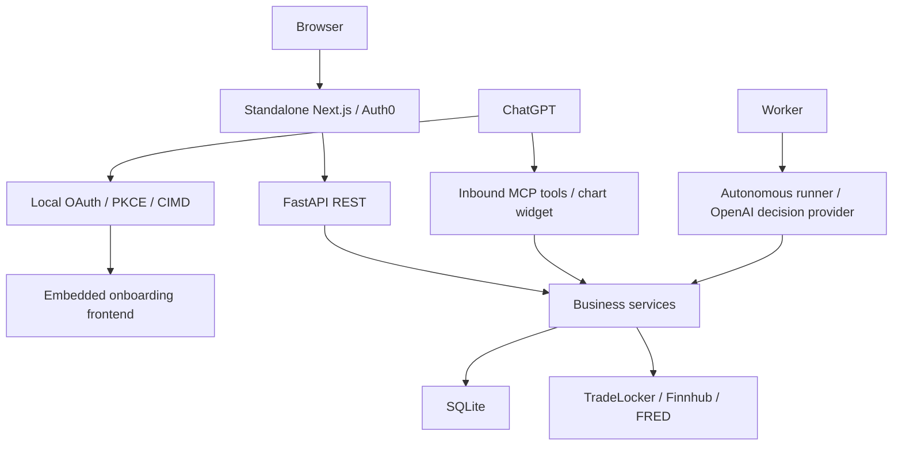
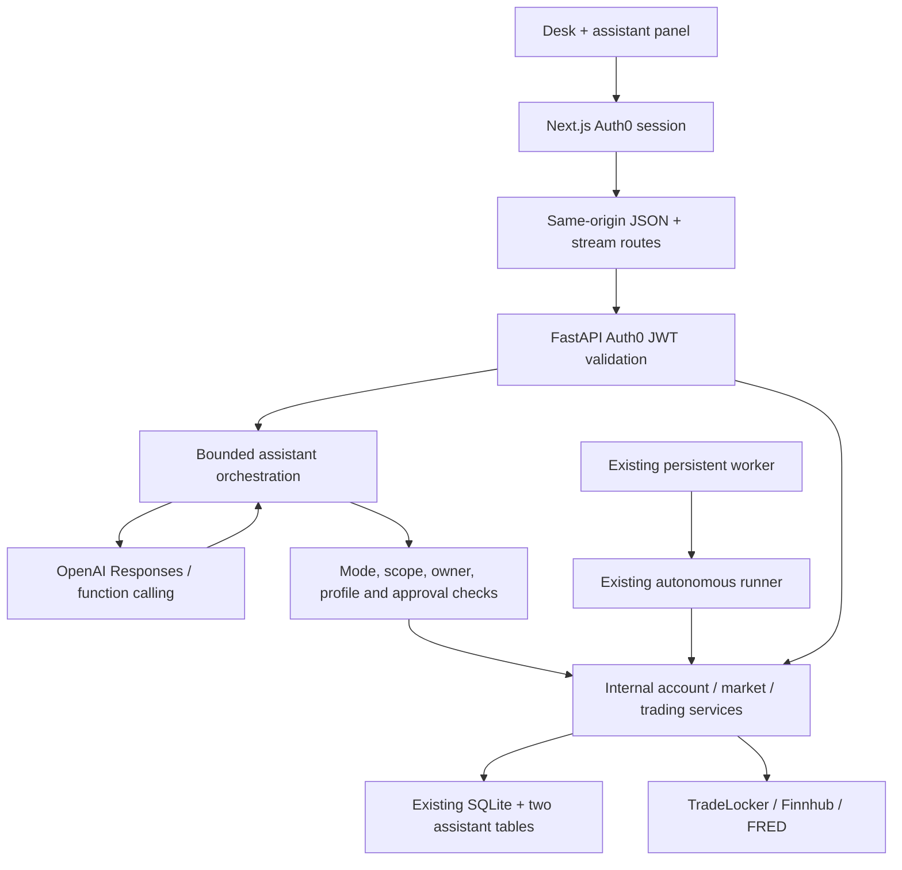
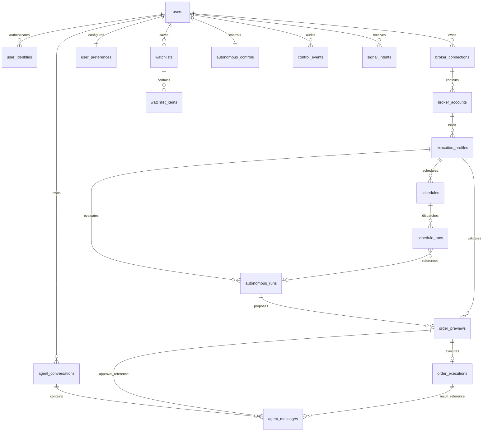

> Historical implementation checkpoint. Superseded by [dashboard-consolidation.md](dashboard-consolidation.md): the dashboard now owns the internal engine and uses one shared workspace without Auth0.

# Agentic Trading Desk — Phases 2–4 implementation report

The native assistant pivot is implemented in local `codex/native-assistant` branches of both repositories. SQLite is still authoritative. No Neon connection, PostgreSQL DDL execution, SQLite data migration, paid OpenAI request or real trade was performed. Production was not deployed. Remote publication was blocked by automatic approval review and has not been retried through another tool.

Backend baseline: `codex/product-ux-contracts` at `c745658b524ba86c797ce98d9106e58c33aa33b3`; the implementation preserves that richer branch's market, provider, order calculation, schedule, preference and dashboard contracts. It does not build against older backend main. Frontend baseline: `e90cd5b411a9f0883b688e45edda145c5c499c2a`.

## 1. Architecture before

External ChatGPT used local OAuth/PKCE/CIMD and inbound MCP. The standalone Auth0 dashboard used FastAPI REST. A separate embedded frontend implemented the ChatGPT authorization/onboarding bridge. Both clients reached existing trading/market services backed by SQLite. The persistent autonomous runner already used OpenAI for structured decisions.

## 2. Architecture after

Browser assistant → Next.js same-origin authenticated stream/JSON routes → FastAPI Auth0 JWT verification → native orchestration/tool registry → OpenAI Responses function calling → internal market/account/trading services. The model does not operate the app by making public REST calls. The existing persistent scheduler and autonomous engine remain intact.

Full before/after diagrams, ERD, contracts and mode matrix appear in the attached design section below.

## 3–5. Files removed, added and modified

Exact per-repository lists are in the file inventory appendix. Large removals are the inbound MCP server/auth transport, local OAuth server/storage/bridge, widget bundle/build and redundant embedded frontend. The standalone dashboard now supplies the native assistant UX. Business test files were retargeted or renamed rather than dropping account/market/execution coverage.

## 6. MCP/OAuth components removed

Removed app/mcp transport, widget resources, FastMCP dependency, /.well-known local issuer metadata, /oauth/authorize and /oauth/token, onboarding assertions/nonce bridge, CIMD/PKCE code, local opaque token issuance/refresh storage code, MCP connection settings/authorized-client revocation UI, MCP-only tests and obsolete setup instructions/configuration. Existing SQLite OAuth rows are not dropped or migrated by this release; the new PostgreSQL design excludes them.

Auth0 application authentication stays: frontend server sessions and token acquisition, backend JWKS/issuer/audience/expiry/subject verification. The JWT verifier was extracted to app/auth/tokens.py before removing MCP. Existing Auth0 audience identifiers and external provider contracts were preserved even where their names contain “mcp.” The unconfigured Robinhood provider placeholder is not the retired inbound ChatGPT product path.

## 7. Reusable business logic preserved

app/mcp/tools.py became app/services/desk_tools.py, with MCP ToolResult/resource presentation replaced by native chart data. Account status/resolution, configured row mapping, market/FRED/Finnhub composition, research bundle construction, broker summaries, preview formatting and safe error contracts remain. AutonomousDemoService, AutonomousDecisionRunner, scheduler, TradeLocker client and risk/sizing/reconciliation behavior remain the execution authority.

ChatGPTAutonomyService was renamed AutonomyControlService; its reusable control behavior remains with neutral labels. The new native tool registry deliberately does not expose its autonomy-enabling/kill-switch-clearing start operation. All stored-key-version decryption paths now use VersionedSecretCipher, including BrokerAccountResolver and account_connection_context; account-record SELECT propagates encryption_key_version. A regression test exercises v2 encryption with a different v1 key and missing-version failure.

One small engine extension accepts an optional backend-only pre-dispatch callback. Native assistant actions use it to recheck profile/session/kill-switch policy after asynchronous broker reads and immediately before the broker write. Existing callers retain their behavior. No broker or risk engine rewrite was performed.

## 8. Native agent tool inventory

| Tool | Server-owned category |
|---|---|
| `emergency_stop_autonomous_trading` | autonomous |
| `get_account_status` | read |
| `get_autonomous_daily_summary` | read |
| `get_autonomous_run_result` | read |
| `get_autonomous_schedule_status` | read |
| `get_autonomous_trading_status` | read |
| `get_demo_execution_status` | read |
| `get_economic_calendar` | read |
| `get_execution_profile` | read |
| `get_forex_research_bundle` | read |
| `get_forex_watchlist` | read |
| `get_macro_release_calendar` | read |
| `get_macro_series` | read |
| `get_market_candles` | read |
| `get_market_news` | read |
| `get_market_summary` | read |
| `get_open_positions` | read |
| `get_order_preview` | read |
| `get_pending_orders` | read |
| `get_provider_capabilities` | read |
| `get_tradelocker_quote` | read |
| `get_tradelocker_symbols` | read |
| `get_watchlist_market_data` | read |
| `list_autonomous_schedules` | read |
| `list_execution_profiles` | read |
| `list_my_tradelocker_accounts` | read |
| `list_my_tradelocker_connections` | read |
| `list_recent_autonomous_runs` | read |
| `pause_schedule` | autonomous |
| `render_market_chart` | read |
| `review_cancel_demo_order` | prepare |
| `review_close_demo_position` | prepare |
| `review_demo_order` | prepare |
| `run_autonomous_demo_profile` | autonomous |
| `search_macro_series` | read |
| `search_markets` | read |
| `stop_autonomous_trading` | autonomous |
| `submit_cancel_demo_order` | execute |
| `submit_close_demo_position` | execute |
| `submit_demo_order` | execute |

40 native tools. Order preview returns the existing deterministic sizing/risk calculation; no fake default-balance executable calculator was introduced. Trade history remains unavailable where the verified broker client has no supported history service. The full legacy wrapper inventory in Phase 1 is not blindly exposed.

## 9. Research / Co-op / Autonomous authorization

Research offers read tools only and rejects fabricated execution calls on the backend. Co-op can prepare previews; execution creates a 60-second opaque user/thread/profile/action/preview-bound approval and returns without trading. Only the separate authenticated approval endpoint can atomically claim it. Expired/replayed/concurrent approval attempts fail closed. No browser-supplied order mutation or approval boolean is trusted.

Autonomous mode requires an owned enabled profile, appropriate scopes and existing controls. New order previews are autonomous-origin previews; manual previews cannot bypass autonomous validation. Profile sessions, instrument/risk/account/demo restrictions, freshness, idempotency and kill switch remain backend concerns. The mode selector never enables autonomy. Live execution stays unsupported. Risk changes, enabling autonomy and disabling kill switches are not agent tools.

## 10. PostgreSQL proposal

Nineteen proposed tables, with internal UUID identity and issuer+subject mapping, tenant/account composite FKs, decimal quantities/money, ciphertext key versions, history retention, indexes, constraints and deletion rules. Chat needs only agent_conversations and agent_messages; existing previews/runs/executions remain the audit authority. No agent_runs/agent_actions duplication, Alembic, import state or generalized migration framework. Complete proposed SQL is appended below and committed at docs/architecture/postgresql-proposal.sql. It was parsed, never applied.

## 11. Exact one-time legacy migration scope

The design section defines deterministic owner/reference predicates for every source table, including all controls, execution outcomes, unknown submissions, historical reconciliation, profile state and watchlists. OAuth/caches/worker liveness/key-migration scaffolding are excluded; unowned historical signal intents are quarantined rather than assigned to a user by guesswork. Referenced snapshots become immutable evidence. Cutover would start blocked, with schedules disabled and no pending preview approvals resumed.

No production SQLite file was provided or opened. Actual row IDs/counts require a separately authorized offline inventory. The report supplies exact selection predicates and transformations; it does not pretend source inspection revealed live database rows.

## 12. Frontend assistant UX

An expandable panel in AppShell survives desk navigation. It includes mode selection, selected account/profile/market/schedule/run context, saved conversation loading, streaming responses, stop generation, tool progress, structured preview fields, co-op approve buttons, execution results and run details. Markets and Trade share selected instruments; Schedules and Activity share relevant selected records. Text renders through React without raw model HTML. Unrelated page layouts were retained.

A dedicated authenticated Next.js SSE path relays upstream.body. Existing JSON endpoints keep their allowlist; same-origin checks protect mutations. No frontend OpenAI key or provider request was added. Stream interruption warns that already dispatched actions may still finish and Activity must be checked before retrying.

## 13. Tests added / retained

New backend test_native_agent.py covers the mode matrix, OAuth scopes, tool argument schemas/extra-key rejection, transcript injection, cross-user conversation/account/profile isolation, atomic turn claims, approval expiry/replay/isolation, human approval before execution, autonomous controls/profile mismatch, research prompt-injection execution denial, SDK Responses stream contract, FastAPI SSE/authentication, provider failure, cancellation, versioned encryption and dispatch-time kill-switch checks.

New frontend assistant.test.ts covers fragmented/multibyte SSE decoding, truncated-stream failure, strict approval route allowlisting, inbound MCP route removal and absence of client-side provider secrets. Existing trading tests remain, with presentation-specific assertions retargeted to native payloads. Existing stale frontend source assertions were updated for current formatting, editable profile names, market-summary contracts and the actual guarded polling condition; their behavioral helper assertions were retained. Incomplete typed fixtures were corrected for type checking.

## 14. Tests run and results

| Check | Result |
|---|---|
| Backend pytest, real integration disabled | **347 passed, 1 skipped**; skipped test is the explicitly opt-in real TradeLocker read |
| Frontend Node/tsx suite | **81 passed, 0 failed** |
| TypeScript tsc --noEmit | Passed |
| Frontend ESLint | 0 errors; 3 pre-existing warnings |
| Next.js production build | Passed; no production credentials supplied |
| PostgreSQL proposal via pglast | Parsed 47 SQL statements / 19 tables; no database involved |
| Backend secret-leak gate | Passed |
| Diff whitespace check | Passed after trailing newline cleanup |
| Browser fixture check | Not completed: browser binary unavailable and its download returned a truncated archive |

The backend has one dependency deprecation warning (Starlette/httpx TestClient). Frontend lint warnings are unused existing StatusPill/accounts and an existing option aria-selected warning. Build also emits existing jose Edge-runtime and missing Auth0 configuration warnings in this credential-free environment. These do not invalidate successful compile/type/build tests, but do not constitute a deployed login/stream validation.

## 15. Remaining blockers

- GitHub push was blocked by automatic approval review, which interpreted remote publication as an unapproved export of source. Both feature branches and commits remain local. No workaround was attempted.
- FastAPI deployment needs OPENAI_API_KEY and explicit AGENT_MODEL; frontend/backend need their existing matching Auth0 settings and backend origin. No secrets were read or copied.
- Real authenticated browser, paid OpenAI and deployed worker-host verification remain to be done in a configured environment. Local tests mock broker/model clients; no real trades were placed.
- Verify old embedded-frontend hosting is retired when deploying this pivot; its source is recoverable in git.
- PostgreSQL stays design-only. Applying it, copying the single legacy user's data, or switching runtime persistence requires a distinct cutover authorization.

## 16. Exact next action requiring authorization

Approve publishing the existing local codex/native-assistant branches to **jnwajei22/agentic-trading-app** and **jnwajei22/agentic-trading-dashboard** on GitHub. This approval is for branch push only, not merging, deploying, Neon changes, migration or trading. Automatic approval review rejected both push attempts because publication trust/scope was not considered explicitly established.

## Design appendix — full architecture, ERD and migration specification

# Native assistant architecture and persistence design

Implementation baseline: `codex/product-ux-contracts` at `c745658b524ba86c797ce98d9106e58c33aa33b3`. Backend main did not contain the standalone dashboard's richer contracts. The implementation branch descends from the richer ref, so merging it includes that valid prior work. Frontend baseline: main `e90cd5b411a9f0883b688e45edda145c5c499c2a`.

## Before



## After



The model receives native function schemas, never application REST credentials or an HTTP tool. It does not call the application's public endpoints. The OpenAI key lives only in FastAPI. Responses are streamed with `store=False`; encrypted reasoning items are carried only during the bounded turn. Visible text is saved locally. No provider response ID is accepted from the browser.

## Contracts and lifecycle

- `POST /api/assistant/stream`: message, optional owned conversation ID, enum mode and structured page context. Unknown keys, browser transcripts and injected system/tool messages are rejected. Ownership of account/profile/schedule/preview/run references is checked before starting a turn.
- `GET /api/assistant/conversations`, `GET /api/assistant/conversations/{id}`: owned history only.
- `POST /api/assistant/conversations/{id}/approvals/{id}`: human-triggered approval. No body containing order parameters, mode, owner or approval booleans is accepted. The backend loads the stored action.
- Browser stream: `/api/assistant/stream` on Next.js. This checks same-origin, Auth0 session, content type and size; it forwards a server-acquired bearer token and relays `upstream.body` without JSON buffering. JSON history/approval requests use the existing narrowly allowlisted proxy; mutation origin checking also protects these actions.
- SSE events: conversation, delta, tool_start, tool_result, error, done. Failed streams do not imply an order was cancelled. The UI explicitly directs the user to check Activity before retrying consequential actions.
- Eight model steps, sixteen tools, 4,000 output tokens/request, 40,000 characters of previous visible conversation and a 240-second turn timeout. Provider retries are disabled at this layer. The existing trading idempotency/reconciliation logic remains authoritative.
- One active turn per conversation uses an atomic SQLite lease; mode/profile are immutable for that conversation. Changing either starts a new thread. Account/market/page context may change, but all references are revalidated at each call.
- Stream cancellation propagates through Next.js to FastAPI/SDK. Already-dispatched broker requests can have unknown outcomes; approval records are never reset for automatic retries.

## Authorization matrix

| Operation | Research | Co-op | Autonomous |
|---|---|---|---|
| Owned markets/accounts/profiles/runs/schedules | Read scope | Read scope | Read scope |
| Prepare order/cancel/close preview | Denied | Preview scope + owned bound enabled profile | Preview scope + owned bound enabled profile |
| Place/cancel/close | Denied | Execute scope + separate expiring claimed approval + revalidation | Execute scope + bound enabled profile + demo control + kill switch clear + revalidation |
| Run profile | Denied | Denied | Execute scope + bound profile; existing runner rechecks controls/risk |
| Stop environment / emergency stop | Denied as model tool | Denied as model tool | Execute scope; stop does not close positions |
| Enable autonomy, disable kill switch, modify risk | No tool | No tool | No tool |
| Live execution | Denied | Unsupported | Unsupported |

The chat selector does not enable trading. The user configures autonomy through the existing dashboard controls. Mode checks are enforced even if the model calls an unavailable or fabricated tool. OAuth scopes supplement mode/profile checks. The assistant cannot mint approvals by saying “approved.” Co-op approvals bind owner, thread, profile, exact action type, immutable preview and idempotency key. They expire in 60 seconds and are atomically claimed before executing; repeats and ambiguous failures require inspection rather than replay.

Profile session restrictions are checked for new entries/profile runs; existing execution services verify allowed instruments, current account routing, broker environment, quantity, protective prices, risk, margin, quote/snapshot freshness and reconciliation. Risk reduction is not blocked merely because the trading session ended. The native registry additionally checks the kill switch before order execution. An optional pre-dispatch guard rechecks mode/profile/session/controls immediately before the broker write, after asynchronous broker reads. It is supplied only by the agent layer; existing engine callers retain their behavior.

## Native service boundaries

`app/services/desk_tools.py` preserves reusable account mapping, provider composition, chart payload validation and demo execution wrappers extracted from MCP. `app/services/agent/tools.py` defines the approved native surface; not every legacy wrapper is exposed. JWT verification moved to `app/auth/tokens.py`. `AutonomyControlService` retains the old control service behavior with neutral labels. No inbound MCP transport, local OAuth token issuer, widget or embedded bridge frontend remains.

The native inventory is the `TOOLS` registry and is reproduced in the implementation report. Compatibility aliases in the extracted service exist for preserved business tests only. The old simplified `/forex/order-preview` remains a non-executing estimate; the assistant does not expose it as an executable preview. The assistant uses `AutonomousDemoService` for all executable previews/actions.

## Frontend

An expandable assistant panel persists in AppShell as users navigate. It has research/co-op/autonomous selection, account/profile context, saved thread loading, streaming text, stop generation, visible tool progress/results, structured preview fields, explicit approve buttons and execution/run details. Markets and Trade publish the selected instrument; profile pages derive the profile; Schedules and Activity publish selected schedule/profile/run context. Context is untrusted data, never authority. React renders text safely without raw HTML. Closing the panel preserves the session; a new thread or mode/profile change resets its visible conversation.

## PostgreSQL design — not applied

`postgresql-proposal.sql` is the complete proposed DDL. No code imports or applies it. No database URL was used. The old disconnected `app/db/schema.sql` is retired to avoid applying the wrong design.

Nineteen tables replace historical SQLite duplication. There are no agent_runs or agent_actions tables: existing autonomous/order execution ledgers own trading facts, while two assistant tables store chat/events/approval pointers. No generalized migration state or repeated-import ID mapping exists. `legacy_ref` is an optional immutable source identifier on historical records, useful for support and deduplication of the one-time copy; it is not a reusable mapping framework.

### Ownership, constraints and deletion

Permanent internal UUID users own every tenant entity. `user_identities(issuer,subject)` is globally unique; initially the issuer is the exact configured Auth0 issuer and subject is the verified JWT sub. Login must resolve this mapping after the future persistence cutover. Composite foreign keys include user/account/profile IDs to prevent cross-tenant and cross-account relationships in the database. Backend SQL must still scope every read/write by owner; the schema is not a public browser-access API. Use a dedicated least-privileged application role and a separate explicitly authorized schema owner. No browser DB credentials.

Financial/audit rows use RESTRICT and soft deletion/anonymization of users/profiles/accounts rather than cascading history away. Deleting a user with financial history first disables access and purges encrypted broker credentials under a separate retention process. Preferences, watchlists and chat history can cascade; execution facts cannot. Immutable previews retain evidence and profile revision. Order/cancel/close previews share a discriminator and structural checks; their executions share idempotency, unknown-result and reconciliation fields. Reconciliation event history is an ordered JSON array attached to its execution.

Indexes cover identity resolution, tenant/time pagination, account/profile lookup, due schedules/retries, one active profile run, unique submission per preview, user idempotency, broker-order identity scoped to account, default accounts/watchlists, alias/name uniqueness and pending approvals. JSON policy/evidence are validated through application Pydantic contracts; SQL checks cover their root shape and executable preview fields. Timestamps use timestamptz, money/quantity use numeric, secrets use ciphertext with required key version. Update timestamps/revisions and immutable-ledger permissions must be maintained by the future repository transaction layer.

### ER relationships



`platform_runtime_settings` is a platform singleton, not a tenant or migration table. Worker heartbeats and rate/candle caches are operational state and need not be durable customer tables in this design.

## Exact one-time copy predicates and legacy disposition

No production SQLite file was supplied or read, so actual row IDs/counts cannot be truthfully asserted. The exact scope below is defined by source predicates; execution requires an authorized offline SQLite inventory and approved cutover. Let U be the one verified legacy user row; S = U.auth0_sub; C = broker_connections WHERE user_id=U.id; A = broker_accounts WHERE user_id=U.id AND connection_id IN C; P = execution_profiles WHERE user_id=U.id AND broker_account_id IN A. Stop on any ownership or reference inconsistency; do not guess or discard unknown broker outcomes. The single operation can keep in-memory dictionaries for new UUID references; no mapping tables/import state will be built.

| SQLite table | Disposition / exact selected rows |
|---|---|
| users | Copy only U to users; create one issuer+S user_identity. Do not use Auth0 sub as permanent UUID. |
| broker_connections | Copy C including disabled connections, ciphertext and encryption_key_version; verify decryption with the configured version without logging plaintext. |
| broker_accounts | Copy A, aliases, default selection, verification/classification/enable state. |
| strategy_templates | No runtime table copy; preserve referenced name/version/config in profile policy/strategy fields or versioned code definitions. |
| execution_profiles | Copy P using validated native/projected V2 policy; preserve bindings/risk/capital/provider/confidence; eliminate deprecated mode/arming duplication. |
| execution_settings | Rows with user_sub=S and routing resolving to A: merge risk/high-water state only where not superseded by P's V2 policy; stop for conflicting live risk state rather than silently preferring it. |
| operational_controls | Preserve deployment-global kill/disable semantics in singleton settings; no user ownership inferred from a global row. |
| autonomous_controls | Copy row user_sub=S; cutover starts blocked (kill=true, demo/live=false) and retains old values in control events for review. Never start a worker automatically. |
| autonomous_control_audit | Copy all rows user_sub=S to control_events. |
| autonomous_snapshots | Copy evidence referenced by selected previews/runs into those records; discard unreferenced expired snapshots. |
| autonomous_order_previews | Copy user_sub=S with bindings resolving to A/P and associated evidence; preserve consumed/rejected; mark all unconsumed historical approvals expired. |
| autonomous_runs | Fold owned historical execution/no-trade records into corresponding decision run/execution using preview/execution references. Preserve unmatched owned historical runs as legacy autonomous_runs; do not duplicate matching ones. |
| autonomous_decision_runs | Copy user_sub=S AND profile_ref IN P.public_id. Include failures, dry runs, usage, reason codes and unknown outcomes. Interrupted states become blocked/unknown after reconciliation, never resumed automatically. |
| broker_submissions | Copy exactly submissions whose preview_id is in selected autonomous_order_previews; retain every claimed/submitting/unknown/rejected/verified state and idempotency fingerprint. |
| demo_action_previews | Copy user_sub=S AND profile_ref IN P AND account_record_id IN A; unify with order_previews using cancel/close discriminator. Expire unused previews. |
| demo_action_executions | Copy user_sub=S whose preview is selected; unify with order_executions. Preserve unknown outcomes. |
| demo_reconciliation_events | Embed every event whose execution_id belongs to selected action executions, ordered by created_at/id. |
| autonomous_schedules | Copy user_sub=S AND profile_ref IN P, preserving timezone/recurrence; initially disabled at cutover. |
| autonomous_schedule_dispatches | Copy user_sub=S for selected schedules; preserve run links/errors/retry history; clear active leases and do not replay historical due times. |
| autonomous_worker_heartbeats | Do not copy ephemeral liveness; workers must register after an approved restart. |
| user_preferences | Copy only user_sub=S, validating timezone/enums/notification shape. |
| user_watchlists | Copy only user_sub=S. |
| user_watchlist_items | Copy only user_sub=S AND watchlist_id in selected lists, normalize canonical IDs/order. Stop for mismatched owner. |
| platform_runtime_settings | Copy recognized current application keys only; retain blocked execution defaults until explicit re-enable. Exclude secrets if any unexpected values are found. |
| signal_intents | Current rows have no owner binding: quarantine in offline legacy backup, copy none as tenant intents. New schema requires a verified owner. |
| credential_key_migrations | Copy none as a runtime table. Retain offline backup only; ciphertext key version stays on each connection. |
| tradelocker_candle_cache | Copy none; rebuild. |
| tradelocker_request_limits | Copy none; rebuild operational counters. |
| oauth_transactions | Copy none. |
| oauth_authorization_codes | Copy none. |
| oauth_access_tokens | Copy none. |
| oauth_refresh_tokens | Copy none. |
| oauth_onboarding_assertion_nonces | Copy none. |
| oauth_client_audit | Copy none to product runtime; preserve offline backup only. |

Renamed historical tables such as broker_connections_legacy/execution_profiles_legacy_mode and sqlite_sequence, if present, are not copied. The future one-time operation must inventory actual table names and fail on unexpected tables. The disconnected old SQL proposal tables (analyses/trades/audit_logs/etc.) are not presumed to exist in SQLite. No oauth_clients/oauth_grants tables were found; none will be created.

## Deployment and remaining limits

Set `OPENAI_API_KEY` and an explicit `AGENT_MODEL` on the FastAPI host only. Keep existing Auth0 issuer/audience/JWKS and encryption keyring settings. Keep frontend Auth0 and BACKEND_API_BASE_URL; there is no frontend OpenAI secret. Start the backend against an isolated copied SQLite database for first deployment verification. Existing lazy SQLite repositories will create the two chat tables when assistant endpoints are first used; this is not a PostgreSQL migration.

No live trading path was added. No paid model invocation, broker invocation, real user login or Neon connection is part of local tests. Unconfigured credentials return a safe assistant error. Production Auth0/OpenAI streaming and existing worker-host integration require deployment credentials. Confirm that no still-active deployment uses the retired embedded frontend before decommissioning its old URL; its code remains recoverable in git.

## SQL appendix — unapplied final proposal

```sql
-- DESIGN ONLY. Not applied. SQLite remains authoritative.
-- No import framework, migration tables, OAuth authorization state or runtime cutover.
CREATE TABLE users (
 id uuid PRIMARY KEY DEFAULT gen_random_uuid(), email text, display_name text,
 status text NOT NULL DEFAULT 'active' CHECK(status IN ('active','disabled','deleted')),
 created_at timestamptz NOT NULL DEFAULT now(), deleted_at timestamptz
);
CREATE TABLE user_identities (
 id uuid PRIMARY KEY DEFAULT gen_random_uuid(), user_id uuid NOT NULL REFERENCES users(id) ON DELETE CASCADE,
 issuer text NOT NULL, subject text NOT NULL, created_at timestamptz NOT NULL DEFAULT now(),
 UNIQUE(issuer,subject)
);
CREATE INDEX user_identities_owner ON user_identities(user_id);
CREATE TABLE broker_connections (
 id uuid PRIMARY KEY DEFAULT gen_random_uuid(), user_id uuid NOT NULL REFERENCES users(id) ON DELETE RESTRICT,
 provider_type text NOT NULL, label text NOT NULL, environment text NOT NULL CHECK(environment IN ('demo','live')),
 endpoint text NOT NULL, username text NOT NULL, credentials_encrypted bytea, encryption_key_version text,
 server text NOT NULL, status text NOT NULL CHECK(status IN ('active','disabled','reauthentication_required')),
 created_at timestamptz NOT NULL DEFAULT now(), updated_at timestamptz NOT NULL DEFAULT now(),
 legacy_ref text UNIQUE, UNIQUE(user_id,id),
 CHECK((credentials_encrypted IS NULL)=(encryption_key_version IS NULL))
);
CREATE TABLE broker_accounts (
 id uuid PRIMARY KEY DEFAULT gen_random_uuid(), user_id uuid NOT NULL REFERENCES users(id) ON DELETE RESTRICT,
 connection_id uuid NOT NULL, broker_account_id text NOT NULL, account_number text NOT NULL,
 alias text NOT NULL, nickname text, currency text, environment text NOT NULL CHECK(environment IN ('demo','live')),
 verified_demo boolean, enabled boolean NOT NULL DEFAULT false, available boolean NOT NULL DEFAULT false,
 is_default boolean NOT NULL DEFAULT false, equity_high_watermark numeric(28,10),
 risk_state jsonb NOT NULL DEFAULT '{}', created_at timestamptz NOT NULL DEFAULT now(),
 legacy_ref text UNIQUE, UNIQUE(user_id,id), UNIQUE(connection_id,broker_account_id,account_number),
 FOREIGN KEY(user_id,connection_id) REFERENCES broker_connections(user_id,id) ON DELETE RESTRICT
);
CREATE UNIQUE INDEX broker_account_alias ON broker_accounts(user_id,lower(alias));
CREATE UNIQUE INDEX one_default_account ON broker_accounts(user_id) WHERE is_default;
CREATE TABLE user_preferences (
 user_id uuid PRIMARY KEY REFERENCES users(id) ON DELETE CASCADE,
 appearance text NOT NULL DEFAULT 'system' CHECK(appearance IN ('system','light','dark')),
 timezone text NOT NULL DEFAULT 'America/Chicago', date_format text NOT NULL DEFAULT 'locale',
 time_format text NOT NULL DEFAULT 'locale', currency_display text NOT NULL DEFAULT 'account',
 notifications jsonb NOT NULL DEFAULT '{}', updated_at timestamptz NOT NULL DEFAULT now()
);
CREATE TABLE watchlists (
 id uuid PRIMARY KEY DEFAULT gen_random_uuid(), user_id uuid NOT NULL REFERENCES users(id) ON DELETE CASCADE,
 name text NOT NULL CHECK(length(name) BETWEEN 1 AND 80), is_default boolean NOT NULL DEFAULT false,
 created_at timestamptz NOT NULL DEFAULT now(), legacy_ref text UNIQUE, UNIQUE(user_id,id)
);
CREATE UNIQUE INDEX watchlist_name ON watchlists(user_id,lower(name));
CREATE UNIQUE INDEX one_default_watchlist ON watchlists(user_id) WHERE is_default;
CREATE TABLE watchlist_items (
 user_id uuid NOT NULL, watchlist_id uuid NOT NULL, canonical_id text NOT NULL,
 position integer NOT NULL CHECK(position>=0), pinned boolean NOT NULL DEFAULT false,
 PRIMARY KEY(watchlist_id,canonical_id), UNIQUE(watchlist_id,position),
 FOREIGN KEY(user_id,watchlist_id) REFERENCES watchlists(user_id,id) ON DELETE CASCADE
);
CREATE TABLE execution_profiles (
 id uuid PRIMARY KEY DEFAULT gen_random_uuid(), user_id uuid NOT NULL REFERENCES users(id) ON DELETE RESTRICT,
 account_id uuid NOT NULL, name text NOT NULL, enabled boolean NOT NULL DEFAULT false,
 schema_version integer NOT NULL DEFAULT 2 CHECK(schema_version=2),
 strategy_ref text NOT NULL, strategy_version text NOT NULL,
 policy jsonb NOT NULL CHECK(jsonb_typeof(policy)='object'),
 decision_provider text NOT NULL CHECK(decision_provider IN ('openai','no_trade')), model_identifier text,
 minimum_confidence numeric(5,4) NOT NULL CHECK(minimum_confidence BETWEEN 0 AND 1),
 revision integer NOT NULL DEFAULT 1 CHECK(revision>0), deleted_at timestamptz,
 legacy_ref text UNIQUE, UNIQUE(user_id,id), UNIQUE(user_id,id,account_id),
 FOREIGN KEY(user_id,account_id) REFERENCES broker_accounts(user_id,id) ON DELETE RESTRICT
);
CREATE INDEX profiles_owner_account ON execution_profiles(user_id,account_id);
CREATE TABLE autonomous_controls (
 user_id uuid PRIMARY KEY REFERENCES users(id) ON DELETE RESTRICT,
 kill_switch boolean NOT NULL DEFAULT true, demo_enabled boolean NOT NULL DEFAULT false,
 live_enabled boolean NOT NULL DEFAULT false, updated_at timestamptz NOT NULL DEFAULT now(), reason text
);
CREATE TABLE control_events (
 id uuid PRIMARY KEY DEFAULT gen_random_uuid(), user_id uuid NOT NULL REFERENCES users(id) ON DELETE RESTRICT,
 control_name text NOT NULL, old_value jsonb NOT NULL, new_value jsonb NOT NULL,
 actor text NOT NULL, source text NOT NULL, reason text, occurred_at timestamptz NOT NULL,
 legacy_ref text UNIQUE
);
CREATE INDEX control_events_owner_time ON control_events(user_id,occurred_at DESC);
CREATE TABLE schedules (
 id uuid PRIMARY KEY DEFAULT gen_random_uuid(), user_id uuid NOT NULL REFERENCES users(id) ON DELETE RESTRICT,
 profile_id uuid NOT NULL, timezone text NOT NULL, recurrence jsonb NOT NULL,
 enabled boolean NOT NULL DEFAULT false, maximum_lateness_seconds integer NOT NULL CHECK(maximum_lateness_seconds BETWEEN 30 AND 3600),
 next_run_at timestamptz, deleted_at timestamptz, legacy_ref text UNIQUE, UNIQUE(user_id,id),
 FOREIGN KEY(user_id,profile_id) REFERENCES execution_profiles(user_id,id) ON DELETE RESTRICT
);
CREATE INDEX schedules_due ON schedules(next_run_at) WHERE enabled AND deleted_at IS NULL;
CREATE TABLE autonomous_runs (
 id uuid PRIMARY KEY DEFAULT gen_random_uuid(), user_id uuid NOT NULL, profile_id uuid NOT NULL, account_id uuid NOT NULL,
 run_key text NOT NULL, trigger_reason text NOT NULL,
 state text NOT NULL CHECK(state IN ('claimed','snapshotting','deciding','validating','previewing','submitting','trade','no_trade','blocked','market_closed','skipped','error','unknown')),
 dry_run boolean NOT NULL DEFAULT false, model_identifier text, context_hash text,
 evidence jsonb NOT NULL DEFAULT '{}', decision jsonb NOT NULL DEFAULT '{}', validation jsonb NOT NULL DEFAULT '{}',
 usage jsonb NOT NULL DEFAULT '{}', reason_codes jsonb NOT NULL DEFAULT '[]',
 started_at timestamptz NOT NULL, completed_at timestamptz, legacy_ref text UNIQUE,
 UNIQUE(user_id,id), UNIQUE(user_id,profile_id,run_key),
 FOREIGN KEY(user_id,profile_id,account_id) REFERENCES execution_profiles(user_id,id,account_id) ON DELETE RESTRICT
);
CREATE UNIQUE INDEX one_active_profile_run ON autonomous_runs(user_id,profile_id)
 WHERE state IN ('claimed','snapshotting','deciding','validating','previewing','submitting');
CREATE INDEX runs_owner_time ON autonomous_runs(user_id,started_at DESC);
CREATE TABLE schedule_runs (
 id uuid PRIMARY KEY DEFAULT gen_random_uuid(), user_id uuid NOT NULL, schedule_id uuid NOT NULL,
 scheduled_at timestamptz NOT NULL, run_id uuid, state text NOT NULL,
 attempts integer NOT NULL DEFAULT 0 CHECK(attempts>=0), retry_at timestamptz,
 lease_owner text, lease_until timestamptz, error_category text, legacy_ref text UNIQUE,
 UNIQUE(schedule_id,scheduled_at), UNIQUE(user_id,id),
 FOREIGN KEY(user_id,schedule_id) REFERENCES schedules(user_id,id) ON DELETE RESTRICT,
 FOREIGN KEY(user_id,run_id) REFERENCES autonomous_runs(user_id,id) ON DELETE RESTRICT
);
CREATE INDEX schedule_runs_retry ON schedule_runs(retry_at) WHERE state='retry_scheduled';
CREATE TABLE order_previews (
 id uuid PRIMARY KEY DEFAULT gen_random_uuid(), user_id uuid NOT NULL, profile_id uuid NOT NULL, account_id uuid NOT NULL,
 run_id uuid, action_type text NOT NULL CHECK(action_type IN ('place_order','cancel_order','close_position')),
 execution_origin text NOT NULL CHECK(execution_origin IN ('co_op','autonomous','manual','legacy')),
 target_id text, canonical_id text, side text CHECK(side IN ('long','short')), order_type text,
 entry numeric(28,10), stop_loss numeric(28,10), take_profit numeric(28,10), quantity numeric(28,10),
 estimated_risk numeric(28,10), estimated_margin numeric(28,10), request_fingerprint text NOT NULL,
 profile_revision integer NOT NULL, evidence jsonb NOT NULL, validation jsonb NOT NULL,
 status text NOT NULL CHECK(status IN ('approved','rejected','expired','consumed')),
 created_at timestamptz NOT NULL, expires_at timestamptz NOT NULL,
 legacy_ref text UNIQUE, UNIQUE(user_id,id), UNIQUE(user_id,id,account_id),
 FOREIGN KEY(user_id,profile_id,account_id) REFERENCES execution_profiles(user_id,id,account_id) ON DELETE RESTRICT,
 FOREIGN KEY(user_id,run_id) REFERENCES autonomous_runs(user_id,id) ON DELETE RESTRICT,
 CHECK(expires_at>created_at), CHECK(quantity IS NULL OR quantity>0),
 CHECK(action_type<>'place_order' OR (canonical_id IS NOT NULL AND side IS NOT NULL AND quantity IS NOT NULL AND stop_loss IS NOT NULL)),
 CHECK(action_type='place_order' OR target_id IS NOT NULL)
);
CREATE INDEX previews_owner_time ON order_previews(user_id,created_at DESC);
CREATE TABLE order_executions (
 id uuid PRIMARY KEY DEFAULT gen_random_uuid(), user_id uuid NOT NULL, account_id uuid NOT NULL, preview_id uuid NOT NULL UNIQUE,
 idempotency_key text NOT NULL, request_fingerprint text NOT NULL,
 state text NOT NULL CHECK(state IN ('claimed','submitting','submitted','verified','rejected','unknown','cancelled','closed')),
 broker_order_id text, broker_position_id text, response_sanitized jsonb NOT NULL DEFAULT '{}',
 reconciliation jsonb NOT NULL DEFAULT '{}', reconciliation_events jsonb NOT NULL DEFAULT '[]',
 submitted_at timestamptz, verified_at timestamptz, created_at timestamptz NOT NULL,
 legacy_ref text UNIQUE, UNIQUE(user_id,id), UNIQUE(user_id,idempotency_key),
 FOREIGN KEY(user_id,preview_id,account_id) REFERENCES order_previews(user_id,id,account_id) ON DELETE RESTRICT
);
CREATE UNIQUE INDEX broker_order_identity ON order_executions(account_id,broker_order_id) WHERE broker_order_id IS NOT NULL;
CREATE INDEX executions_owner_time ON order_executions(user_id,created_at DESC);
CREATE TABLE signal_intents (
 id uuid PRIMARY KEY DEFAULT gen_random_uuid(), user_id uuid NOT NULL REFERENCES users(id) ON DELETE RESTRICT,
 profile_id uuid, provider_type text NOT NULL, canonical_id text NOT NULL,
 idempotency_key text NOT NULL, payload jsonb NOT NULL, status text NOT NULL DEFAULT 'untrusted',
 created_at timestamptz NOT NULL DEFAULT now(), expires_at timestamptz NOT NULL,
 UNIQUE(user_id,provider_type,idempotency_key),
 FOREIGN KEY(user_id,profile_id) REFERENCES execution_profiles(user_id,id) ON DELETE RESTRICT
);
CREATE INDEX signal_intents_owner_time ON signal_intents(user_id,created_at DESC);
CREATE TABLE platform_runtime_settings (
 singleton boolean PRIMARY KEY DEFAULT true CHECK(singleton), configuration jsonb NOT NULL,
 updated_at timestamptz NOT NULL DEFAULT now()
);
CREATE TABLE agent_conversations (
 id uuid PRIMARY KEY DEFAULT gen_random_uuid(), user_id uuid NOT NULL REFERENCES users(id) ON DELETE CASCADE,
 mode text NOT NULL CHECK(mode IN ('research','co_op','autonomous')), profile_id uuid,
 created_at timestamptz NOT NULL DEFAULT now(), busy_until timestamptz,
 UNIQUE(user_id,id), FOREIGN KEY(user_id,profile_id) REFERENCES execution_profiles(user_id,id) ON DELETE RESTRICT
);
CREATE INDEX agent_conversations_owner_time ON agent_conversations(user_id,created_at DESC);
CREATE TABLE agent_messages (
 id uuid PRIMARY KEY DEFAULT gen_random_uuid(), user_id uuid NOT NULL, conversation_id uuid NOT NULL,
 sequence bigint GENERATED ALWAYS AS IDENTITY, kind text NOT NULL CHECK(kind IN ('user','assistant','tool','approval','execution')),
 payload jsonb NOT NULL, state text NOT NULL CHECK(state IN ('pending','claimed','complete')),
 preview_id uuid, execution_id uuid, expires_at timestamptz, created_at timestamptz NOT NULL DEFAULT now(),
 UNIQUE(conversation_id,sequence),
 FOREIGN KEY(user_id,conversation_id) REFERENCES agent_conversations(user_id,id) ON DELETE CASCADE,
 FOREIGN KEY(user_id,preview_id) REFERENCES order_previews(user_id,id) ON DELETE RESTRICT,
 FOREIGN KEY(user_id,execution_id) REFERENCES order_executions(user_id,id) ON DELETE RESTRICT,
 CHECK(kind<>'approval' OR (preview_id IS NOT NULL AND expires_at IS NOT NULL))
);
CREATE INDEX pending_agent_approvals ON agent_messages(user_id,expires_at) WHERE kind='approval' AND state='pending';

CREATE INDEX connections_owner ON broker_connections(user_id);
CREATE INDEX accounts_owner_connection ON broker_accounts(user_id,connection_id);
CREATE INDEX schedules_owner_profile ON schedules(user_id,profile_id);
CREATE INDEX schedule_runs_owner_schedule ON schedule_runs(user_id,schedule_id,scheduled_at DESC);
CREATE INDEX schedule_runs_run ON schedule_runs(user_id,run_id);
CREATE INDEX previews_owner_profile ON order_previews(user_id,profile_id);
CREATE INDEX previews_run ON order_previews(user_id,run_id);
CREATE INDEX signals_profile ON signal_intents(user_id,profile_id);
CREATE INDEX conversation_profile ON agent_conversations(user_id,profile_id);
CREATE INDEX agent_messages_preview ON agent_messages(user_id,preview_id) WHERE preview_id IS NOT NULL;
CREATE INDEX agent_messages_execution ON agent_messages(user_id,execution_id) WHERE execution_id IS NOT NULL;
```

## Exact file inventory relative to implementation baselines

### Backend


#### Removed

- `app/api/routes/integrations.py`
- `app/api/routes/oauth.py`
- `app/auth/onboarding.py`
- `app/db/schema.sql`
- `app/mcp/__init__.py`
- `app/mcp/auth.py`
- `app/mcp/server.py`
- `app/mcp/tools.py`
- `app/oauth/__init__.py`
- `app/oauth/cimd.py`
- `app/oauth/constants.py`
- `app/storage/oauth.py`
- `docs/chatgpt-mcp-setup.md`
- `frontend/.env.example`
- `frontend/.gitignore`
- `frontend/README.md`
- `frontend/eslint.config.mjs`
- `frontend/next-env.d.ts`
- `frontend/next.config.ts`
- `frontend/package-lock.json`
- `frontend/package.json`
- `frontend/pnpm-lock.yaml`
- `frontend/src/app/api/backend/[...path]/route.ts`
- `frontend/src/app/connect-tradelocker/form.tsx`
- `frontend/src/app/connect-tradelocker/page.tsx`
- `frontend/src/app/dashboard/accounts-panel.tsx`
- `frontend/src/app/dashboard/loading.tsx`
- `frontend/src/app/dashboard/page.tsx`
- `frontend/src/app/globals.css`
- `frontend/src/app/layout.tsx`
- `frontend/src/app/navigation.tsx`
- `frontend/src/app/oauth/complete/route.ts`
- `frontend/src/app/oauth/start/route.ts`
- `frontend/src/app/onboarding/page.tsx`
- `frontend/src/app/onboarding/resume/route.ts`
- `frontend/src/app/page.tsx`
- `frontend/src/app/select-account/page.tsx`
- `frontend/src/app/select-account/selector.tsx`
- `frontend/src/app/settings/page.tsx`
- `frontend/src/app/settings/panel.tsx`
- `frontend/src/app/setup-complete/page.tsx`
- `frontend/src/components/app-modal.tsx`
- `frontend/src/components/onboarding-shell.tsx`
- `frontend/src/components/retry-button.tsx`
- `frontend/src/components/schedule-modal.tsx`
- `frontend/src/components/status-badge.tsx`
- `frontend/src/lib/auth0.ts`
- `frontend/src/lib/autonomous-ui.test.ts`
- `frontend/src/lib/backend-error-message.ts`
- `frontend/src/lib/backend-runtime.test.ts`
- `frontend/src/lib/backend-runtime.ts`
- `frontend/src/lib/backend-server.test.ts`
- `frontend/src/lib/backend.ts`
- `frontend/src/lib/browser-backend.test.ts`
- `frontend/src/lib/browser-backend.ts`
- `frontend/src/lib/chatgpt-return.test.ts`
- `frontend/src/lib/chatgpt-return.ts`
- `frontend/src/lib/connection-alert.ts`
- `frontend/src/lib/dashboard-contracts.ts`
- `frontend/src/lib/dashboard-data.test.ts`
- `frontend/src/lib/dashboard-data.ts`
- `frontend/src/lib/display.test.ts`
- `frontend/src/lib/display.ts`
- `frontend/src/lib/onboarding-assertion.ts`
- `frontend/src/lib/onboarding-backend.ts`
- `frontend/src/lib/onboarding-http.ts`
- `frontend/src/lib/onboarding-transaction.ts`
- `frontend/src/lib/schedule.test.ts`
- `frontend/src/lib/schedule.ts`
- `frontend/src/lib/session.ts`
- `frontend/src/lib/status.test.ts`
- `frontend/src/lib/status.ts`
- `frontend/src/lib/tradelocker-status.ts`
- `frontend/src/lib/ui-contract.test.ts`
- `frontend/src/proxy.ts`
- `frontend/tsconfig.json`
- `logs/mcp-followup-test.log`
- `tests/integration/test_mcp_server.py`
- `tests/integration/test_mcp_settings.py`
- `tests/integration/test_oauth_onboarding.py`
- `tests/unit/test_chatgpt_autonomy_control.py`
- `tests/unit/test_cimd.py`
- `tests/unit/test_mcp_tradelocker_rows.py`
- `tests/unit/test_oauth_refresh.py`
- `widget/NOTICE.md`
- `widget/dist/index.html`
- `widget/index.html`
- `widget/package-lock.json`
- `widget/package.json`
- `widget/src/chart.ts`
- `widget/src/main.ts`
- `widget/src/styles.css`
- `widget/tests/chart.test.ts`
- `widget/tests/setup.ts`
- `widget/tsconfig.json`
- `widget/vite.config.ts`

#### Added

- `app/api/routes/agent.py`
- `app/auth/tokens.py`
- `app/services/agent/__init__.py`
- `app/services/agent/contracts.py`
- `app/services/agent/service.py`
- `app/services/agent/tools.py`
- `app/services/desk_tools.py`
- `app/storage/agent.py`
- `docs/architecture/native-assistant.md`
- `docs/architecture/postgresql-proposal.sql`
- `tests/unit/test_account_rows.py`
- `tests/unit/test_autonomy_control_service.py`
- `tests/unit/test_native_agent.py`

#### Modified

- `.env.example`
- `README.md`
- `app/api/routes/platform.py`
- `app/config/settings.py`
- `app/main.py`
- `app/services/autonomous/control.py`
- `app/services/autonomous/execution.py`
- `app/services/tradelocker/accounts.py`
- `app/storage/brokers.py`
- `docs/autonomous-demo-release-gate.md`
- `docs/autonomous-demo-runner.md`
- `docs/autonomous-scheduler-operations.md`
- `docs/autonomous-worker-deployment.md`
- `docs/folder-map.md`
- `docs/openapi.json`
- `docs/tradelocker-demo-execution.md`
- `docs/tradelocker-multi-account.md`
- `docs/tradelocker-onboarding-status.md`
- `pyproject.toml`
- `requirements.txt`
- `tests/integration/test_platform.py`
- `tests/unit/test_account_status_tool.py`
- `tests/unit/test_candle_history.py`
- `tests/unit/test_market_chart_tool.py`
- `tests/unit/test_research_bundle.py`


### Standalone frontend


#### Removed

- `app/(desk)/settings/integrations/mcp/page.tsx`
- `app/(desk)/settings/integrations/mcp/settings.tsx`
- `components/settings/chatgpt-setup-instructions.tsx`
- `lib/afd/mcp.ts`
- `tests/mcp-settings.test.ts`

#### Added

- `app/api/assistant/stream/route.ts`
- `components/desk/assistant-panel.tsx`
- `components/desk/assistant-result.tsx`
- `lib/afd/assistant-context.ts`
- `lib/afd/assistant.ts`
- `tests/assistant.test.ts`

#### Modified

- `README.md`
- `app/(desk)/activity/workspace.tsx`
- `app/(desk)/markets/workspace.tsx`
- `app/(desk)/schedules/schedule-manager.tsx`
- `app/(desk)/settings/page.tsx`
- `app/(desk)/trade/workspace.tsx`
- `app/api/afd/[...path]/route.ts`
- `components/desk/app-shell.tsx`
- `lib/afd/contracts.ts`
- `lib/afd/routes.ts`
- `tests/display-refinements.test.ts`
- `tests/product-contract.test.ts`
- `tests/production-ux.test.ts`
- `tests/profile-editor-ux.test.ts`
- `tests/provider-refactor.test.ts`
- `tests/routes.test.ts`
- `tests/trade-refinement.test.ts`


The report itself is additionally added as docs/architecture/implementation-report.md. The library delivery copy includes the same content.

## Official API reference consulted

https://developers.openai.com/api/docs/guides/function-calling
