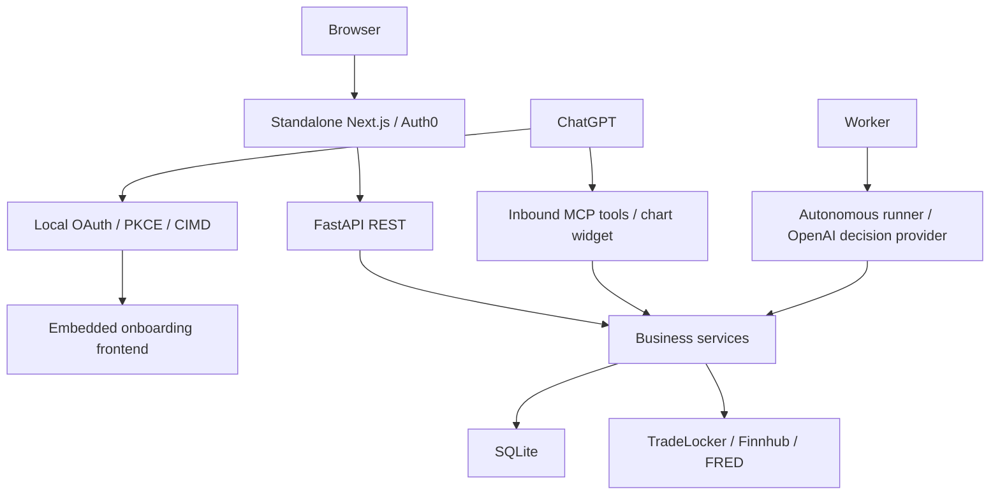
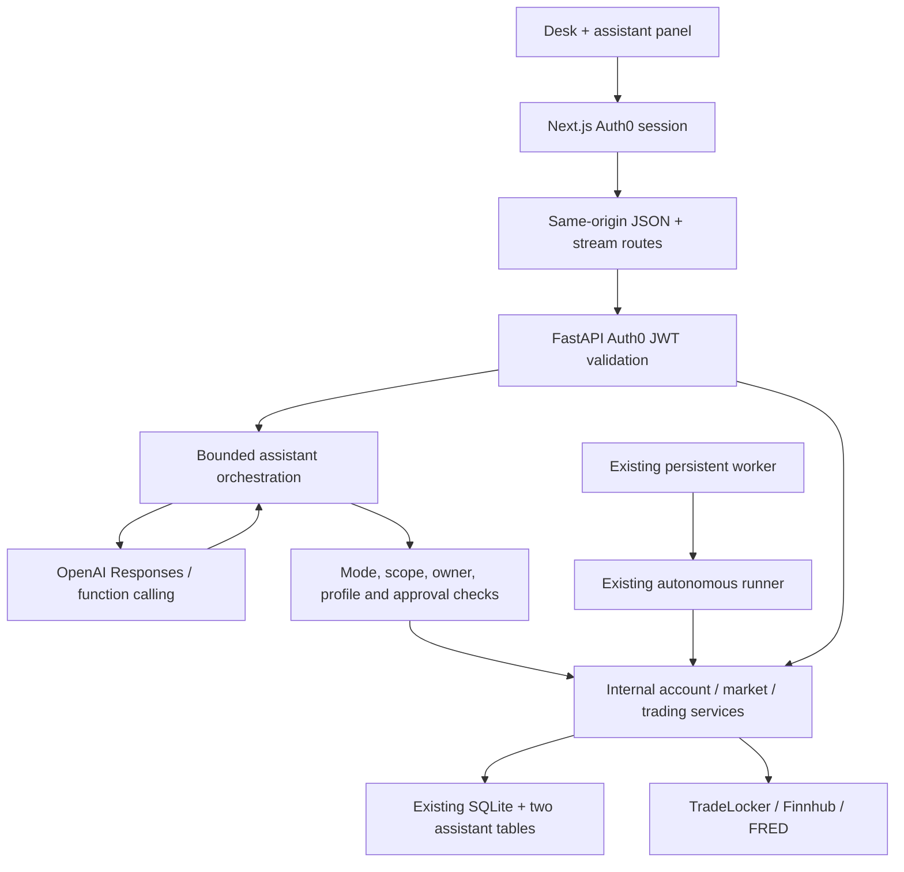
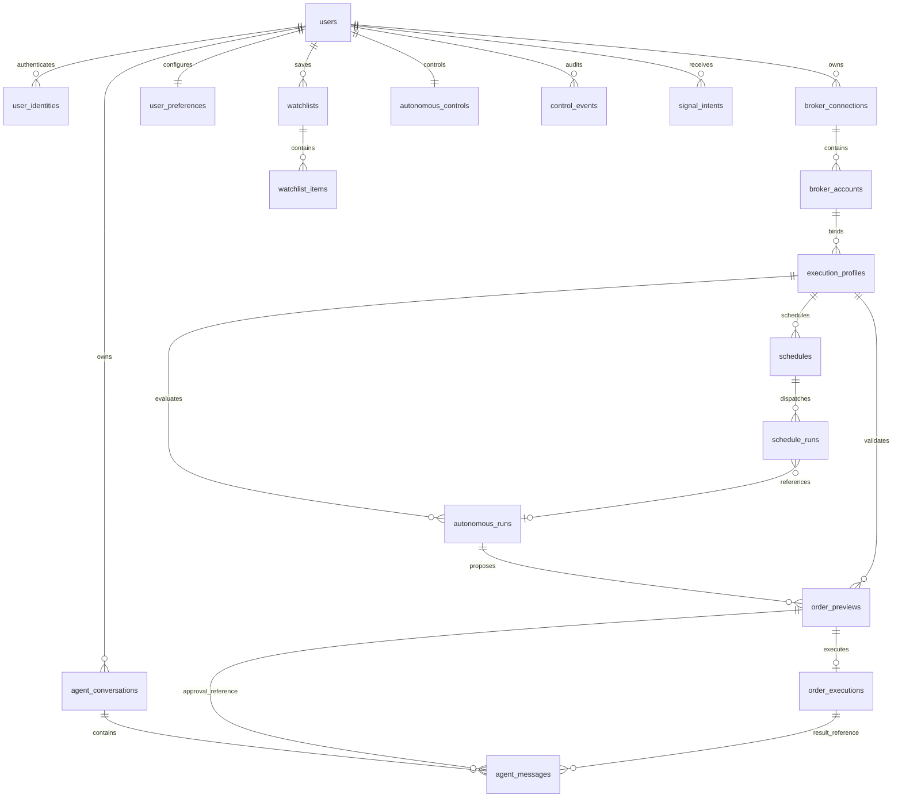

> Historical implementation checkpoint. Superseded by [dashboard-consolidation.md](dashboard-consolidation.md): the dashboard now owns the internal engine and uses one shared workspace without Auth0.

# Native assistant architecture and persistence design

Implementation baseline: `codex/product-ux-contracts` at `c745658b524ba86c797ce98d9106e58c33aa33b3`. Backend main did not contain the standalone dashboard's richer contracts. The implementation branch descends from the richer ref, so merging it includes that valid prior work. Frontend baseline: main `e90cd5b411a9f0883b688e45edda145c5c499c2a`.

## Before

## After

The model receives native function schemas, never application REST credentials or an HTTP tool. It does not call the application's public endpoints. The OpenAI key lives only in FastAPI. Responses are streamed with `store=False`; encrypted reasoning items are carried only during the bounded turn. Visible text is saved locally. No provider response ID is accepted from the browser.

## Contracts and lifecycle

- `POST /api/assistant/stream`: message, optional owned conversation ID, enum mode and structured page context. Unknown keys, browser transcripts and injected system/tool messages are rejected. Ownership of account/profile/schedule/preview/run references is checked before starting a turn.
- `GET /api/assistant/conversations`, `GET /api/assistant/conversations/{id}`: owned history only.
- `POST /api/assistant/conversations/{id}/approvals/{id}`: human-triggered approval. No body containing order parameters, mode, owner or approval booleans is accepted. The backend loads the stored action.
- Browser stream: `/api/assistant/stream` on Next.js. This checks same-origin, Auth0 session, content type and size; it forwards a server-acquired bearer token and relays `upstream.body` without JSON buffering. JSON history/approval requests use the existing narrowly allowlisted proxy; mutation origin checking also protects these actions.
- SSE events: conversation, delta, tool_start, tool_result, error, done. Failed streams do not imply an order was cancelled. The UI explicitly directs the user to check Activity before retrying consequential actions.
- Eight model steps, sixteen tools, 4,000 output tokens/request, 40,000 characters of previous visible conversation and a 240-second turn timeout. Provider retries are disabled at this layer. The existing trading idempotency/reconciliation logic remains authoritative.
- One active turn per conversation uses an atomic SQLite lease; mode/profile are immutable for that conversation. Changing either starts a new thread. Account/market/page context may change, but all references are revalidated at each call.
- Stream cancellation propagates through Next.js to FastAPI/SDK. Already-dispatched broker requests can have unknown outcomes; approval records are never reset for automatic retries.

## Authorization matrix

| Operation | Research | Co-op | Autonomous |
|---|---|---|---|
| Owned markets/accounts/profiles/runs/schedules | Read scope | Read scope | Read scope |
| Prepare order/cancel/close preview | Denied | Preview scope + owned bound enabled profile | Preview scope + owned bound enabled profile |
| Place/cancel/close | Denied | Execute scope + separate expiring claimed approval + revalidation | Execute scope + bound enabled profile + demo control + kill switch clear + revalidation |
| Run profile | Denied | Denied | Execute scope + bound profile; existing runner rechecks controls/risk |
| Stop environment / emergency stop | Denied as model tool | Denied as model tool | Execute scope; stop does not close positions |
| Enable autonomy, disable kill switch, modify risk | No tool | No tool | No tool |
| Live execution | Denied | Unsupported | Unsupported |

The chat selector does not enable trading. The user configures autonomy through the existing dashboard controls. Mode checks are enforced even if the model calls an unavailable or fabricated tool. OAuth scopes supplement mode/profile checks. The assistant cannot mint approvals by saying “approved.” Co-op approvals bind owner, thread, profile, exact action type, immutable preview and idempotency key. They expire in 60 seconds and are atomically claimed before executing; repeats and ambiguous failures require inspection rather than replay.

Profile session restrictions are checked for new entries/profile runs; existing execution services verify allowed instruments, current account routing, broker environment, quantity, protective prices, risk, margin, quote/snapshot freshness and reconciliation. Risk reduction is not blocked merely because the trading session ended. The native registry additionally checks the kill switch before order execution. An optional pre-dispatch guard rechecks mode/profile/session/controls immediately before the broker write, after asynchronous broker reads. It is supplied only by the agent layer; existing engine callers retain their behavior.

## Native service boundaries

`app/services/desk_tools.py` preserves reusable account mapping, provider composition, chart payload validation and demo execution wrappers extracted from MCP. `app/services/agent/tools.py` defines the approved native surface; not every legacy wrapper is exposed. JWT verification moved to `app/auth/tokens.py`. `AutonomyControlService` retains the old control service behavior with neutral labels. No inbound MCP transport, local OAuth token issuer, widget or embedded bridge frontend remains.

The native inventory is the `TOOLS` registry and is reproduced in the implementation report. Compatibility aliases in the extracted service exist for preserved business tests only. The old simplified `/forex/order-preview` remains a non-executing estimate; the assistant does not expose it as an executable preview. The assistant uses `AutonomousDemoService` for all executable previews/actions.

## Frontend

An expandable assistant panel persists in AppShell as users navigate. It has research/co-op/autonomous selection, account/profile context, saved thread loading, streaming text, stop generation, visible tool progress/results, structured preview fields, explicit approve buttons and execution/run details. Markets and Trade publish the selected instrument; profile pages derive the profile; Schedules and Activity publish selected schedule/profile/run context. Context is untrusted data, never authority. React renders text safely without raw HTML. Closing the panel preserves the session; a new thread or mode/profile change resets its visible conversation.

## PostgreSQL design — not applied

`postgresql-proposal.sql` is the complete proposed DDL. No code imports or applies it. No database URL was used. The old disconnected `app/db/schema.sql` is retired to avoid applying the wrong design.

Nineteen tables replace historical SQLite duplication. There are no agent_runs or agent_actions tables: existing autonomous/order execution ledgers own trading facts, while two assistant tables store chat/events/approval pointers. No generalized migration state or repeated-import ID mapping exists. `legacy_ref` is an optional immutable source identifier on historical records, useful for support and deduplication of the one-time copy; it is not a reusable mapping framework.

### Ownership, constraints and deletion

Permanent internal UUID users own every tenant entity. `user_identities(issuer,subject)` is globally unique; initially the issuer is the exact configured Auth0 issuer and subject is the verified JWT sub. Login must resolve this mapping after the future persistence cutover. Composite foreign keys include user/account/profile IDs to prevent cross-tenant and cross-account relationships in the database. Backend SQL must still scope every read/write by owner; the schema is not a public browser-access API. Use a dedicated least-privileged application role and a separate explicitly authorized schema owner. No browser DB credentials.

Financial/audit rows use RESTRICT and soft deletion/anonymization of users/profiles/accounts rather than cascading history away. Deleting a user with financial history first disables access and purges encrypted broker credentials under a separate retention process. Preferences, watchlists and chat history can cascade; execution facts cannot. Immutable previews retain evidence and profile revision. Order/cancel/close previews share a discriminator and structural checks; their executions share idempotency, unknown-result and reconciliation fields. Reconciliation event history is an ordered JSON array attached to its execution.

Indexes cover identity resolution, tenant/time pagination, account/profile lookup, due schedules/retries, one active profile run, unique submission per preview, user idempotency, broker-order identity scoped to account, default accounts/watchlists, alias/name uniqueness and pending approvals. JSON policy/evidence are validated through application Pydantic contracts; SQL checks cover their root shape and executable preview fields. Timestamps use timestamptz, money/quantity use numeric, secrets use ciphertext with required key version. Update timestamps/revisions and immutable-ledger permissions must be maintained by the future repository transaction layer.

### ER relationships

`platform_runtime_settings` is a platform singleton, not a tenant or migration table. Worker heartbeats and rate/candle caches are operational state and need not be durable customer tables in this design.

## Exact one-time copy predicates and legacy disposition

No production SQLite file was supplied or read, so actual row IDs/counts cannot be truthfully asserted. The exact scope below is defined by source predicates; execution requires an authorized offline SQLite inventory and approved cutover. Let U be the one verified legacy user row; S = U.auth0_sub; C = broker_connections WHERE user_id=U.id; A = broker_accounts WHERE user_id=U.id AND connection_id IN C; P = execution_profiles WHERE user_id=U.id AND broker_account_id IN A. Stop on any ownership or reference inconsistency; do not guess or discard unknown broker outcomes. The single operation can keep in-memory dictionaries for new UUID references; no mapping tables/import state will be built.

| SQLite table | Disposition / exact selected rows |
|---|---|
| users | Copy only U to users; create one issuer+S user_identity. Do not use Auth0 sub as permanent UUID. |
| broker_connections | Copy C including disabled connections, ciphertext and encryption_key_version; verify decryption with the configured version without logging plaintext. |
| broker_accounts | Copy A, aliases, default selection, verification/classification/enable state. |
| strategy_templates | No runtime table copy; preserve referenced name/version/config in profile policy/strategy fields or versioned code definitions. |
| execution_profiles | Copy P using validated native/projected V2 policy; preserve bindings/risk/capital/provider/confidence; eliminate deprecated mode/arming duplication. |
| execution_settings | Rows with user_sub=S and routing resolving to A: merge risk/high-water state only where not superseded by P's V2 policy; stop for conflicting live risk state rather than silently preferring it. |
| operational_controls | Preserve deployment-global kill/disable semantics in singleton settings; no user ownership inferred from a global row. |
| autonomous_controls | Copy row user_sub=S; cutover starts blocked (kill=true, demo/live=false) and retains old values in control events for review. Never start a worker automatically. |
| autonomous_control_audit | Copy all rows user_sub=S to control_events. |
| autonomous_snapshots | Copy evidence referenced by selected previews/runs into those records; discard unreferenced expired snapshots. |
| autonomous_order_previews | Copy user_sub=S with bindings resolving to A/P and associated evidence; preserve consumed/rejected; mark all unconsumed historical approvals expired. |
| autonomous_runs | Fold owned historical execution/no-trade records into corresponding decision run/execution using preview/execution references. Preserve unmatched owned historical runs as legacy autonomous_runs; do not duplicate matching ones. |
| autonomous_decision_runs | Copy user_sub=S AND profile_ref IN P.public_id. Include failures, dry runs, usage, reason codes and unknown outcomes. Interrupted states become blocked/unknown after reconciliation, never resumed automatically. |
| broker_submissions | Copy exactly submissions whose preview_id is in selected autonomous_order_previews; retain every claimed/submitting/unknown/rejected/verified state and idempotency fingerprint. |
| demo_action_previews | Copy user_sub=S AND profile_ref IN P AND account_record_id IN A; unify with order_previews using cancel/close discriminator. Expire unused previews. |
| demo_action_executions | Copy user_sub=S whose preview is selected; unify with order_executions. Preserve unknown outcomes. |
| demo_reconciliation_events | Embed every event whose execution_id belongs to selected action executions, ordered by created_at/id. |
| autonomous_schedules | Copy user_sub=S AND profile_ref IN P, preserving timezone/recurrence; initially disabled at cutover. |
| autonomous_schedule_dispatches | Copy user_sub=S for selected schedules; preserve run links/errors/retry history; clear active leases and do not replay historical due times. |
| autonomous_worker_heartbeats | Do not copy ephemeral liveness; workers must register after an approved restart. |
| user_preferences | Copy only user_sub=S, validating timezone/enums/notification shape. |
| user_watchlists | Copy only user_sub=S. |
| user_watchlist_items | Copy only user_sub=S AND watchlist_id in selected lists, normalize canonical IDs/order. Stop for mismatched owner. |
| platform_runtime_settings | Copy recognized current application keys only; retain blocked execution defaults until explicit re-enable. Exclude secrets if any unexpected values are found. |
| signal_intents | Current rows have no owner binding: quarantine in offline legacy backup, copy none as tenant intents. New schema requires a verified owner. |
| credential_key_migrations | Copy none as a runtime table. Retain offline backup only; ciphertext key version stays on each connection. |
| tradelocker_candle_cache | Copy none; rebuild. |
| tradelocker_request_limits | Copy none; rebuild operational counters. |
| oauth_transactions | Copy none. |
| oauth_authorization_codes | Copy none. |
| oauth_access_tokens | Copy none. |
| oauth_refresh_tokens | Copy none. |
| oauth_onboarding_assertion_nonces | Copy none. |
| oauth_client_audit | Copy none to product runtime; preserve offline backup only. |

Renamed historical tables such as broker_connections_legacy/execution_profiles_legacy_mode and sqlite_sequence, if present, are not copied. The future one-time operation must inventory actual table names and fail on unexpected tables. The disconnected old SQL proposal tables (analyses/trades/audit_logs/etc.) are not presumed to exist in SQLite. No oauth_clients/oauth_grants tables were found; none will be created.

## Deployment and remaining limits

Set `OPENAI_API_KEY` and an explicit `AGENT_MODEL` on the FastAPI host only. Keep existing Auth0 issuer/audience/JWKS and encryption keyring settings. Keep frontend Auth0 and BACKEND_API_BASE_URL; there is no frontend OpenAI secret. Start the backend against an isolated copied SQLite database for first deployment verification. Existing lazy SQLite repositories will create the two chat tables when assistant endpoints are first used; this is not a PostgreSQL migration.

No live trading path was added. No paid model invocation, broker invocation, real user login or Neon connection is part of local tests. Unconfigured credentials return a safe assistant error. Production Auth0/OpenAI streaming and existing worker-host integration require deployment credentials. Confirm that no still-active deployment uses the retired embedded frontend before decommissioning its old URL; its code remains recoverable in git.
